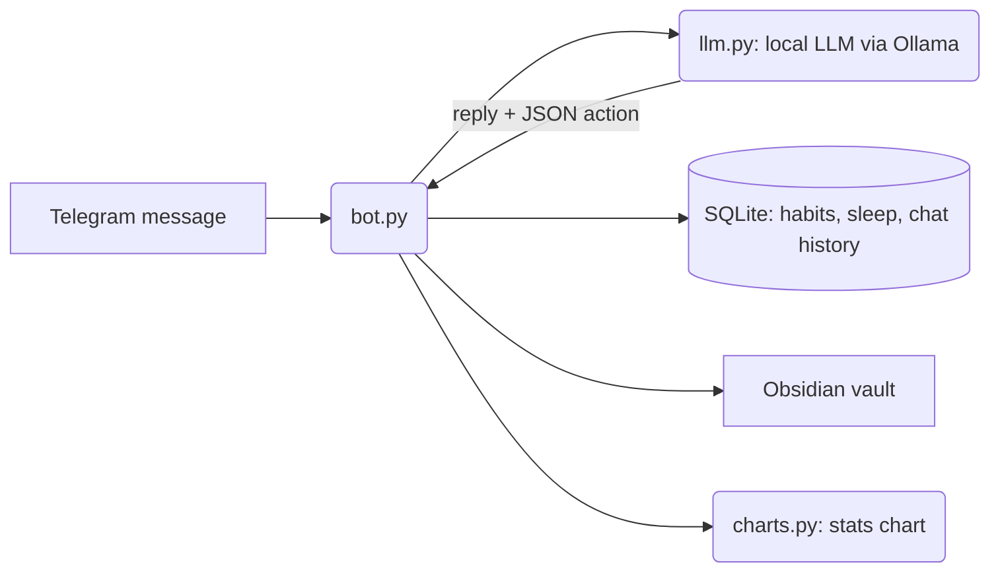

# Jarvis – Personal AI Assistant on Telegram

A private Telegram assistant powered by a **local LLM (Ollama)**. You chat with it naturally, and it decides on its own when to log a habit, record sleep or save a note to your Obsidian vault.

## Features

- **Natural-language actions (tool calling):** the LLM detects intent ("Gym done!", "I slept 8 hours") and returns a structured JSON action that the bot executes
- **Habit tracking** with tap-to-complete buttons
- **Sleep logging**
- **Obsidian notes:** create or append notes in your vault from Telegram
- **Conversation memory** stored in SQLite
- **Photo understanding** through a vision model
- **Monthly statistics charts** (Matplotlib) comparing this month to last month
- **Security:** user ID whitelist, path-traversal protection for note paths, secrets kept in `.env`

## How it works



## Commands

| Command | What it does |
| --- | --- |
| `/habits` | Show today's habits and check them off |
| `/addhabit <name>` | Add a habit |
| `/deletehabit <name>` | Remove a habit |
| `/sleep <hours>` | Log sleep |
| `/note <path> <content>` | Write or append an Obsidian note |
| `/stats` | Chart of this month vs last month |
| `/clearhistory` | Clear conversation memory |

## Tech stack

Python, pyTelegramBotAPI, Ollama (Qwen / Llama 3.1, Llama 3.2 Vision), SQLite, Matplotlib, python-dotenv

## Run it

```bash
ollama pull llama3.1            # or a Qwen model
python -m venv .venv && source .venv/bin/activate
pip install -r requirements.txt
cp env.example .env             # add your bot token, Telegram user ID and vault path
python bot.py
```
